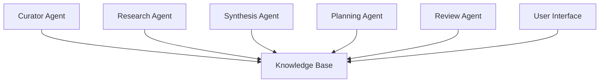

# Second Brain AI - Vision & Architecture

## Table of Contents
- [Overview](#overview)
- [Vision](#vision)
- [Current POC Architecture](#current-poc-architecture)
- [Future Architecture](#future-architecture)
- [Technical Implementation](#technical-implementation)
- [Agent System](#agent-system)
- [Getting Started](#getting-started)
- [Roadmap](#roadmap)

## Overview

Second Brain AI is an intelligent knowledge management system that combines the PARA methodology (Projects, Areas, Resources, Archives) with advanced AI capabilities to create a living, evolving knowledge ecosystem. It not only organizes information but actively participates in knowledge synthesis, discovery, and creation.

## Vision

The ultimate vision is to create a system that acts as an intelligent research partner, knowledge curator, and insight generator. Key aspects:

- **Active Knowledge Management**: Beyond passive storage, the system actively processes, connects, and synthesizes information
- **Autonomous Agents**: A team of specialized AI agents that continuously work with your knowledge base
- **Emergent Insights**: Discovery of non-obvious connections and generation of novel ideas
- **Adaptive Organization**: Self-organizing knowledge structure that evolves with usage
- **Research Partnership**: Acts as a collaborative research partner, suggesting new directions and synthesizing findings

## Current POC Architecture

### Core Components

1. **Data Ingestion Layer**

```82:100:main.py
# SQLite settings: a local file "second_brain.db"
DB_PATH = "second_brain.db"

# --- Database Setup ---
def init_db():
    conn = sqlite3.connect(Config.DB_PATH)
    cursor = conn.cursor()
    cursor.execute("""
        CREATE TABLE IF NOT EXISTS session_data (
            id TEXT PRIMARY KEY,
            data TEXT NOT NULL,
            para_type TEXT NOT NULL,
            para_status TEXT NOT NULL,
            created_at TIMESTAMP NOT NULL,
            last_modified TIMESTAMP NOT NULL
        );
    """)
    conn.commit()
    return conn, cursor
```


2. **PARA Structure**
- Projects: Time-bound initiatives
- Areas: Ongoing responsibilities
- Resources: Reference materials
- Archives: Inactive items

3. **Basic Processing Pipeline**
- Text structuring
- Metadata extraction
- PARA categorization
- Basic linking

### Current Schema

```7:55:prompts.py
{{
  "session": {{
    "session_id": "<generated UUID>",
    "user_id": "{user_id}",
    "started_at": "<ISO 8601 timestamp of session start>",
    "summary": "<concise, insightful summary of the entire session>"
  }},
  "records": [
    {{
      "record_id": "<generated UUID>",
      "session_id": "<same as session.session_id>",
      "para_type": "one of [project, area, resource, archive]",
      "para_status": "one of [active, inactive]",
      "type": "one of [idea, task, quote, reminder, plan, research_request, agent_reflection]",
      "content": "<fully synthesized and clarified version>",
      "created_at": "<ISO 8601 timestamp>",
      "tags": ["<meaningful, topic-relevant tags>", "..."],
      "links": ["<record_id of related records>", "..."],
      "details": {{
          "title": "<concise, informative title>",
          "priority": "one of [high, medium, low] if applicable",
          "notes": "<additional context or suggestions>",
          "due_date": "<ISO 8601 timestamp if applicable>",
          "completion_criteria": "<specific criteria for projects>",
          "maintenance_requirements": "<specific requirements for areas>"
      }},
      "para_metadata": {{
          "project": {{
              "goal": "<specific project goal>",
              "deadline": "<ISO 8601 timestamp>",
              "status": "one of [planning, in_progress, completed, on_hold]"
          }},
          "area": {{
              "responsibility": "<ongoing responsibility description>",
              "review_frequency": "<review period in days>"
          }},
          "resource": {{
              "category": "<topic or reference category>",
              "format": "<type of resource: document, link, note, etc.>"
          }},
          "archive": {{
              "archived_date": "<ISO 8601 timestamp>",
              "original_para_type": "one of [project, area, resource]",
              "reason": "<reason for archiving>"
          }}
      }}
    }}
  ]
}}
```


## Future Architecture

### Enhanced Components

1. **Multi-Modal Ingestion Layer**
- Document processing (PDF, Word, etc.)
- Voice transcription
- Image analysis
- Web content
- Academic papers
- Code repositories

2. **Vector Storage Layer**
- Multiple embedding spaces
  - Semantic embeddings
  - Task embeddings
  - Concept embeddings
  - Temporal embeddings
- Cross-referencing capabilities
- Dynamic index updates

3. **Agent System**



#### Agent Types
- **Curator Agent**: Organizes and maintains knowledge structure
- **Research Agent**: Conducts independent research on topics
- **Synthesis Agent**: Creates summaries and identifies patterns
- **Planning Agent**: Suggests action items and project plans
- **Review Agent**: Periodically reviews and refreshes content

4. **Knowledge Graph**
- Concept mapping
- Relationship inference
- Dynamic restructuring
- Temporal tracking

5. **Interface Layer**
- Web interface
- Mobile app
- API access
- CLI tools
- Obsidian plugin

### Technical Implementation

1. **Embedding System**
```python
from sentence_transformers import SentenceTransformer
from qdrant_client import QdrantClient

class EmbeddingSystem:
    def __init__(self):
        self.semantic_model = SentenceTransformer('all-mpnet-base-v2')
        self.concept_model = SentenceTransformer('sentence-t5-xl')
        self.vector_db = QdrantClient("localhost", port=6333)
    
    def create_embeddings(self, text, embedding_type="semantic"):
        if embedding_type == "semantic":
            return self.semantic_model.encode(text)
        return self.concept_model.encode(text)
```

2. **Agent Framework**
```python
class BaseAgent:
    def __init__(self, knowledge_base, embedding_system):
        self.kb = knowledge_base
        self.embeddings = embedding_system
        self.memory = ConversationBufferMemory()
        
    async def run_cycle(self):
        relevant_context = self.get_context()
        thoughts = self.analyze(relevant_context)
        actions = self.plan_actions(thoughts)
        await self.execute_actions(actions)
```

## Getting Started

1. Clone the repository
2. Install dependencies: `pip install -r requirements.txt`
3. Set up environment variables
4. Initialize the database: `python init_db.py`
5. Run the system: `python main.py`

## Roadmap

### Phase 1 (Current POC)
- [x] Basic PARA implementation
- [x] Simple text processing
- [x] Initial database structure
- [x] Basic API integration

### Phase 2 (Next Steps)
- [ ] Vector embedding integration
- [ ] Basic agent implementation
- [ ] Enhanced metadata extraction
- [ ] Improved linking system

### Phase 3 (Future)
- [ ] Multi-agent system
- [ ] Advanced research capabilities
- [ ] Knowledge graph implementation
- [ ] UI/UX development

### Phase 4 (Vision)
- [ ] Autonomous research
- [ ] Predictive insights
- [ ] Collaborative features
- [ ] API ecosystem

## Contributing

[Contributing guidelines]

## License

MIT License

Would you like me to expand on any particular aspect of this architecture?
