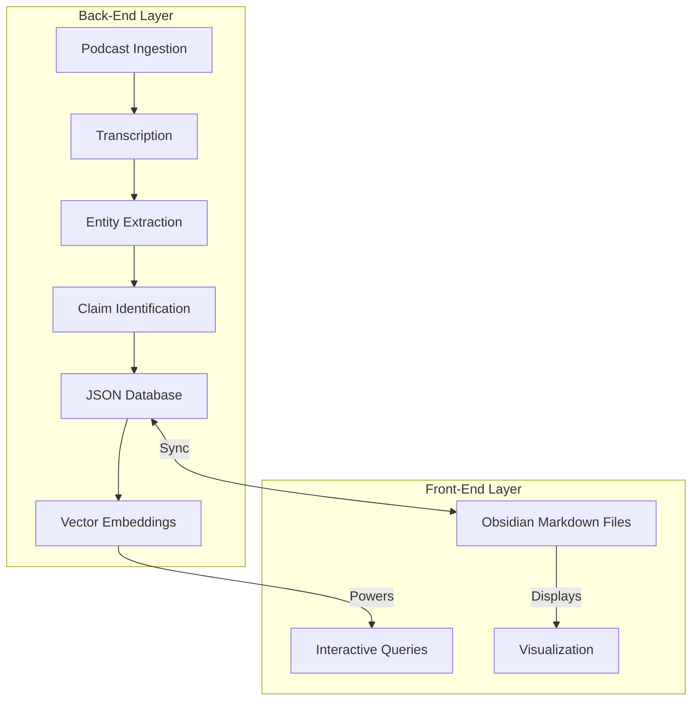

# FTFM System Architecture: Back-end JSON to Front-end Obsidian

## Overview
This component of the [[FTFM - Public Accountability Information System]] focuses on the technical architecture that will power the system. The architecture follows a two-layer approach with separation between data storage/processing and user interface.

> [!GOAL]
> Build a working prototype of the two-layer system architecture with sync functionality by February 28, 2024.

## System Design

## Back-end Components

### Data Storage
- **JSON Database**: Structured data store containing:
  - Entities (people, organizations, places, events)
  - Claims and statements
  - Source information with timestamps
  - Relationship mappings
- **Vector Embeddings**: Semantic representation of content for AI retrieval

### Processing
- Entity extraction pipeline
- Claim detection algorithm
- Contradiction and pattern analysis
- RAG (Retrieval-Augmented Generation) system for queries

## Front-end Components

### Obsidian Interface
- Markdown files representing:
  - Entities with their statements and history
  - Topics and their evolution
  - Source materials with annotations
- Bidirectional links between related concepts
- Visualization of statement networks and timelines

### Synchronization
- Real-time or scheduled sync between JSON database and markdown files
- Change tracking and version history
- Conflict resolution for manual edits

## Implementation Approach
This system will be implemented as a RAG (Retrieval-Augmented Generation) pipeline. The back-end will handle heavy computation and AI processing, while the front-end focuses on user interaction and visualization.

## Tasks
- [ ] Design JSON schema for structured data
- [ ] Implement embedding generation for semantic search
- [ ] Create markdown templates for different entity types
- [ ] Develop synchronization mechanism between layers
- [ ] Build query interface for AI-powered searches
- [ ] Implement visualization components

## Completion Criteria
A functioning system with:
- Demonstrable sync between JSON database and Obsidian notes
- AI query capabilities against the structured data
- Ability for users to explore connections through Obsidian interface